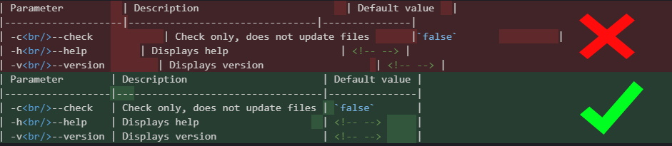

<!-- markdownlint-disable MD033 MD041 -->

# Markdown table formatter

[](https://npmjs.org/package/markdown-table-formatter)
[](https://npmjs.org/package/markdown-table-formatter)
[](https://npmjs.org/package/markdown-table-formatter)
[](https://github.com/nvuillam/mega-linter#readme)<!-- gh-dependents-info-used-by-start -->
[](https://github.com/nvuillam/markdown-table-formatter/blob/main/docs/github-dependents-info.md)<!-- gh-dependents-info-used-by-end -->
[](https://codecov.io/gh/nvuillam/markdown-table-formatter)
[](https://gitHub.com/nvuillam/markdown-table-formatter/graphs/contributors/)
[](https://GitHub.com/nvuillam/markdown-table-formatter/stargazers/)
[](https://github.com/nvuillam/markdown-table-formatter/blob/master/LICENSE)
[](http://makeapullrequest.com)

Format markdown tables in files, with a fast formatting engine written in Rust and embedded as WebAssembly.

No dependencies, the same npm package works on every platform (Windows, macOS, Linux, x64 and arm64) with Node.js 22+.

The formatting rules come from [markdown-table-prettify](https://github.com/darkriszty/MarkdownTablePrettify-VSCodeExt) 4.x, plus some fixes: tables in code blocks are left untouched and column widths follow the Unicode display width (CJK, kana, hangul, emoji...).

[](https://github.com/nvuillam/markdown-table-formatter#readme)

## Table of contents

- [Installation](#installation)
  - [Local](#local)
  - [Global](#global)
- [Usage](#usage)
  - [Options](#options)
- [Examples](#examples)
- [Continuous Integration](#continuous-integration)
- [Ignoring Code Blocks](#ignoring-code-blocks)
- [Debug](#debug)
- [Contribute](#contribute)
- [Release notes](#release-notes)

## Installation

### Local

```shell
npm install markdown-table-formatter --save
```

### Global

```shell
npm install markdown-table-formatter -g
```

## Usage

```shell
markdown-table-formatter [OPTIONS] (file(s) or glob expression)
```

### Options

| Parameter              | Description                              | Default value |
|------------------------|------------------------------------------|---------------|
| -c<br/>--check         | Check only, does not update files        | `false`       |
| -p<br/>--columnpadding | Override column padding number of spaces | `0`           |
| -z<br/>--verbose       | Verbose mode                             | `false`       |
| -h<br/>--help          | Displays help                            | <!-- -->      |
| -v<br/>--version       | Displays version                         | <!-- -->      |

## Examples

Format all markdown files found within current directory

```shell
markdown-table-formatter
```

Format all markdown files found with a glob expression

```shell
markdown-table-formatter **/docs/*.md
```

Format markdown tables in a single file

```shell
markdown-table-formatter myfile.md
```

Format markdown tables in a multiple file

```shell
markdown-table-formatter myfile.md anotherFile.md andAnotherFile.md
```

Check if markdown table formatting is necessary in a single file

```shell
markdown-table-formatter --check myfile.md
```

Check if markdown table formatting is necessary in a multiple files

```shell
markdown-table-formatter --check myfile.md anotherFile.md andAnotherFile.md
```

You can see **more examples in** [**test methods**](https://github.com/nvuillam/markdown-table-formatter/blob/master/test/markdown-table-formatter.test.js)

## Continuous Integration

You can automatically check markdown tables formatting and fix it using [MegaLinter](https://github.com/oxsecurity/megalinter/), that embeds markdown-table-formatter out of the box

## Ignoring Code Blocks

You may wish to ignore specific markdown content, especially when using with [Megalinter](https://github.com/oxsecurity/megalinter) or [terraform-docs](https://github.com/terraform-docs/terraform-docs)

To achieve this, place tags `<!-- markdown-table-prettify-ignore-start -->` and `<!-- markdown-table-prettify-ignore-end -->` around the content you want markdown-table-formatter to ignore.

Tables inside fenced code blocks (` ``` ` or `~~~`) and indented code blocks are never formatted.

## Debug

Set environment variable `NODE_DEBUG=markdown-table-formatter` to display debug logs.

## Contribute

Contributions are very welcome !

Please follow [Contribution instructions](https://github.com/nvuillam/markdown-table-formatter/blob/master/CONTRIBUTING.md)

## Release Notes

See complete [CHANGELOG](https://github.com/nvuillam/markdown-table-formatter/blob/master/CHANGELOG.md)
